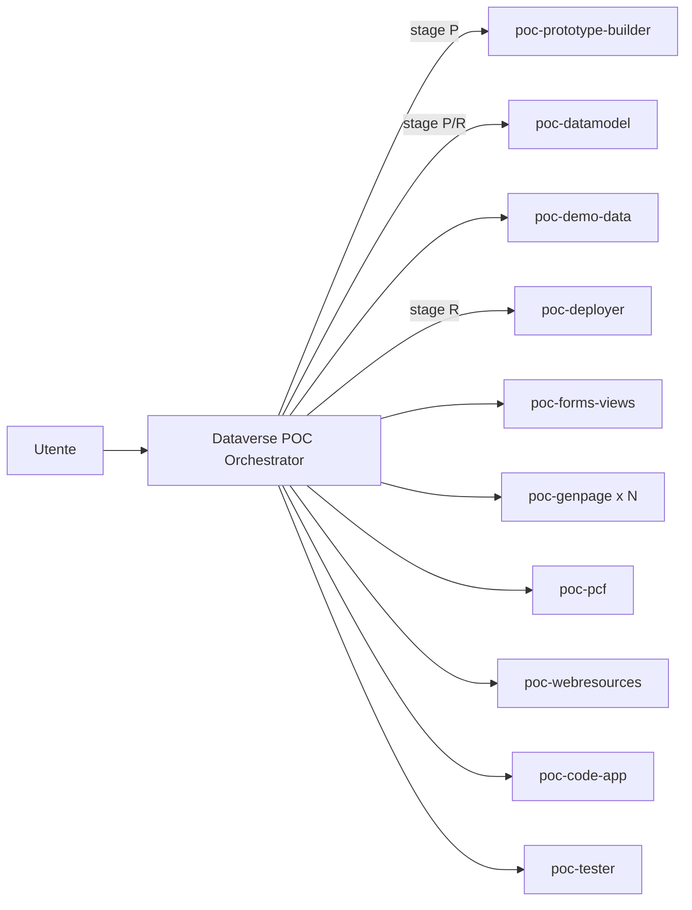

## 🧪 dataverse-poc

Plugin per agenti AI (**VS Code / GitHub Copilot**, **Copilot CLI**, **Claude Code**) che gestisce le **POC su Dataverse e Power Platform**. Un orchestratore pianifica il lavoro e lo delega a sotto-agenti specializzati, dal prototipo HTML/YAML fino alla realizzazione in un ambiente DEV e al rilascio. Contenuti e istruzioni sono in italiano.

Fa parte del marketplace [power-platform-plugins](https://github.com/raythekool/power-platform-plugins).

### 📦 Cosa contiene

| Componente | Tipo | Visibile all'utente | Ruolo |
| --- | --- | --- | --- |
| `Dataverse POC Orchestrator` | agente (Copilot) / skill `orchestrator` (Claude) | sì | Pianifica, apre gli stage con conferma, delega, verifica, aggiorna il piano |
| `poc-prototype-builder` | agente | no | Prototipo HTML/YAML (model-driven o code app), componenti simulati, build |
| `poc-datamodel` | agente | no | Standard vs custom (Microsoft Learn), contratto YAML; in stage R tabelle, colonne, choice, relazioni, chiavi con PACX |
| `poc-demo-data` | agente | no | Dataset sintetici YAML; in stage R seed dei record |
| `poc-forms-views` | agente | no | Form, viste, app module, sitemap con AppMaker MCP e PACX |
| `poc-genpage` | agente | no | Una generative page per invocazione: `.tsx`, compilazione, upload |
| `poc-pcf` | agente | no | Controlli PCF: manifest, implementazione, PCF Workbench, push |
| `poc-webresources` | agente | no | JavaScript di form, HTML/CSS, icone tabelle, comandi ribbon |
| `poc-code-app` | agente | no | Power Apps code app (React/Vite) per POC `appType: code-app` |
| `poc-tester` | agente | no | Verifica indipendente: validator, smoke test Playwright, metadata, browser |
| `poc-deployer` | agente | no | Preflight ambiente, solution, publish, export/import, inventario cleanup |
| `dataverse-poc-planner` | skill | `/` | appType, scope, schermate, percorso demo |
| `dataverse-poc-schema` | skill | `/` | Contratto Dataverse di tabelle e colonne |
| `dataverse-poc-model-driven` | skill | `/` | Prototipo model-driven con chrome Dynamics 365 CE |
| `dataverse-poc-code-app` | skill | `/` | Prototipo code app |
| `dataverse-poc-pipeline` | skill | `/` | Scaffold, validator, build, smoke test, copertura requisiti |
| `dataverse-poc-realization` | skill | no | Contratto multi-agente: stage gate, brief/report, ownership, guardrail, gotcha |
| `prototype-dataverse-app` | skill | no | Riferimenti e asset condivisi (schema YAML, shell D365, app standard, smoke test) |
| `poc-guard` | hook `PreToolUse` | — | Chiede conferma prima di comandi PAC/PACX distruttivi, cambi di ambiente, URL espliciti, import di solution |

### 🧭 Come funziona



| Stage | Cosa produce | Gate |
| --- | --- | --- |
| P — Prototipo | YAML + HTML runtime/statico con componenti simulati | `appType` deciso con l'utente |
| R — Realizzazione DEV | Metadata, dati demo, UI, pagine, controlli in un ambiente DEV | Prototipo validato e ambiente, solution, prefisso, LCID confermati |
| D — Rilascio | Export/import verso altri ambienti | Conferma per ogni rilascio |

L'orchestratore tiene lo stato in un **documento di piano** (`POC/Piano_<Iniziativa>_<Cliente>.md`) con la tabella `🎯 Target ambiente`. Ogni sotto-agente riceve un brief autosufficiente e restituisce un report standard (`COMPLETATO` / `PARZIALE` / `BLOCCATO`). Il contratto completo è in [dataverse-poc-realization](skills/dataverse-poc-realization/SKILL.md).

### 🚀 Installazione

Il plugin si installa dal marketplace `raythekool/power-platform-plugins`.

**🟦 VS Code (GitHub Copilot)**

1. Nelle impostazioni abilitare **Chat > Plugins: Enabled**.
2. Aggiungere `raythekool/power-platform-plugins` a **Chat > Plugins: Marketplaces** (`chat.plugins.marketplaces`).
3. Nella vista Extensions cercare `@agentPlugins dataverse-poc` e installare.

**⌨️ GitHub Copilot CLI**

```shell
copilot plugin marketplace add raythekool/power-platform-plugins
copilot plugin install dataverse-poc@power-platform-plugins
```

**🟠 Claude Code**

```shell
/plugin install dataverse-poc --marketplace raythekool/power-platform-plugins
```

Oppure in due passi, anche dalla shell: `claude plugin marketplace add raythekool/power-platform-plugins`, poi `claude plugin install dataverse-poc@power-platform-plugins`.

Per lo sviluppo si può caricare la cartella locale: in VS Code con `"chat.pluginLocations": { "<percorso>/plugins/dataverse-poc": true }`, in Claude Code con `claude --plugin-dir <percorso>/plugins/dataverse-poc`.

Se un repository contiene già copie locali degli stessi agenti o skill (in `.github/agents/`, `.github/skills/` o `.claude/`), vanno rimosse: i nomi duplicati confondono la scelta del sotto-agente.

### 💬 Uso

| | VS Code / Copilot CLI | Claude Code |
| --- | --- | --- |
| Avvio | Selezionare l'agente **Dataverse POC Orchestrator** | Lanciare `/dataverse-poc:orchestrator <richiesta>` |
| Sotto-agenti | Nascosti (`user-invocable: false`), elencati in `agents:` dell'orchestratore | `dataverse-poc:poc-*`, invocati dall'orchestratore con lo strumento Agent |
| Skill | `/dataverse-poc-planner`, ... | `/dataverse-poc:dataverse-poc-planner`, ... |

1. Descrivere requisiti, POC esistente o cartella, e fin dove arrivare (prototipo, realizzazione DEV, rilascio).
2. Rispondere alle domande su `appType` e prefisso. Prima dello stage R rispondere anche su ambiente e solution.

In Claude Code l'orchestratore è una skill e non un agente, perché lì un sotto-agente non può avviare altri sotto-agenti. I file in `claude/` sono generati da `agents/` (vedi [CONTRIBUTING](https://github.com/raythekool/power-platform-plugins/blob/main/CONTRIBUTING.md)): non vanno modificati a mano.

### 🧰 Prerequisiti

- Node.js (validator, build e smoke test delle POC; script del hook).
- `pac` (Power Platform CLI) e `pacx` per lo stage R; profili di autenticazione già creati dall'utente.
- Edge o Chrome installati per lo smoke test (`playwright-core` non scarica browser).
- Server MCP configurati nel client. Gli agenti Copilot li referenziano con i nomi qui sotto e ignorano gli strumenti non disponibili. In Claude Code i sotto-agenti ereditano tutti i server MCP configurati; conviene usare gli stessi nomi.

| Nome atteso | Uso |
| --- | --- |
| `local-microsoftdocs/mcp` | Microsoft Learn: riuso tabelle standard, documentazione |
| `appmaker` | AppMaker (Dataverse): metadata, form, viste, app module, sitemap |
| `local-playwright` | Verifiche nel browser |
| `icons` | Icone delle tabelle |
| `local-microsoft/markitdown` | Conversione di documenti sorgente in Markdown |

Le skill di altri plugin richiamate per nome (`pacx-*`, `appmaker-*`, `pcf-*`, `genpage`, `create-code-app`, `deploy`, `model-driven-ribbon-*`, `test-automation`) vengono dai plugin Power Platform e P.R.I.S.M.A. già installati. Senza quei plugin gli agenti funzionano lo stesso, ma con meno guida.

### ⚠️ Limiti noti

- Il hook usa la decisione `ask`. VS Code e Claude Code aprono la conferma; in Copilot CLI il comportamento dipende dal supporto di `ask` nella versione in uso.
- Il hook ispeziona solo i comandi da terminale e gli strumenti MCP con `delete` nel nome: non sostituisce i permessi in Dataverse.
- Lo smoke test presuppone le convenzioni dei renderer della skill (`[data-nav]`, `tr[data-open]`, `[data-form-tab]`, `.sim-frame`).

### 📜 Versioni

[CHANGELOG.md](CHANGELOG.md) · Licenza [MIT](LICENSE)
