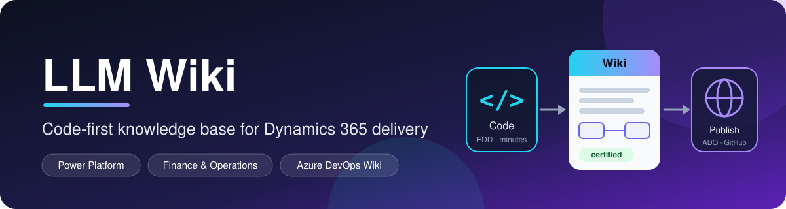

<p align="center">
  
</p>

📦 The **LLM Wiki** plugin for GitHub Copilot (VS Code, Copilot CLI) and Claude Code. Full description, install steps and screenshots: see the [plugin guide](../../docs/power-platform-llm-wiki/README.md). It is part of the [power-platform-plugins](../../README.md) marketplace.

Quick install in Claude Code:

```shell
/plugin install power-platform-llm-wiki --marketplace raythekool/power-platform-plugins
```

## 🧱 Components

> [!IMPORTANT]
> Always type the full command name: `/power-platform-wiki-init`, `/power-platform-wiki-config`, `/power-platform-wiki-update`, `/power-platform-wiki-ingest`, `/power-platform-wiki-query`. The short names (`/init`, `/update`, ...) belong to the tool itself and do not run this plugin. In Claude Code the canonical form is `/power-platform-llm-wiki:power-platform-wiki-init`; the bare `/power-platform-wiki-init` works as long as no other command has the same name.

|     | Component        | Path                       | Purpose                                                                                                |
| --- | ---------------- | -------------------------- | ------------------------------------------------------------------------------------------------------ |
| 🤖   | Agent            | `agents/llm-wiki.agent.md` | **LLM Wiki** agent: bootstrap, routing to skills, core rules                                           |
| 🧙   | Skill `power-platform-wiki-init`     | `skills/power-platform-wiki-init/`             | Wizard, scaffolding, engine installation, host integration (assets in `skills/power-platform-wiki-init/assets/`)           |
| ⚙️   | Skill `power-platform-wiki-config`   | `skills/power-platform-wiki-config/`           | Change settings, `--refresh-engine`, `--migrate` (v2 -> v3)                                            |
| 🔄   | Skill `power-platform-wiki-update`   | `skills/power-platform-wiki-update/`           | Sources (code, devops, dataverse, fno, github), `--full`, `--lint`, `--publish`, `--sprint`, lifecycle |
| 📥   | Skill `power-platform-wiki-ingest`   | `skills/power-platform-wiki-ingest/`           | Meetings, FDD, TDD, ADR, generic documents                                                             |
| 💬   | Skill `power-platform-wiki-query`    | `skills/power-platform-wiki-query/`            | Grounded answers with citations                                                                        |
| 📘   | Operating manual | `references/AGENTS.md`     | Installed as `llm-wiki/AGENTS.md`                                                                      |
| 🧩   | Profiles         | `references/profiles/`     | `power-platform`, `dynamics-fno`, `generic`                                                            |
| 🌐   | Publishing       | `references/publishing.md` | Azure DevOps Wiki / GitHub Wiki procedure                                                              |
| 📝   | Templates        | `templates/`               | meeting, requirement, design, adr, code-component, source                                              |

## 🐚 Scripts (PowerShell 7, JSON output)

| Script                     | Purpose                                                                                                                        |
| -------------------------- | ------------------------------------------------------------------------------------------------------------------------------ |
| 📦 `Install-Engine.ps1`     | Copies AGENTS.md, scripts, templates, profiles and headless skill copies into `llm-wiki/`                                      |
| 🧰 `Test-Prerequisites.ps1` | Read-only check of the tools (git, GCM, tf, pacx/pac, gh, markitdown, node, agent tools): found, missing, required by features |
| 🔁 `Get-RawDelta.ps1`       | Incremental detection of new / changed / to-convert sources (SHA-256 manifest)                                                 |
| 🔬 `Get-CodeInventory.ps1`  | Inventory of CE / Power Platform components and F&O Ax* metadata                                                               |
| 🕸️ `Get-WikiGraph.ps1`      | Knowledge graph: query / impact / path, knowledge map, AI pack (`graph.json`, `llms.txt`, `graph.html`)                        |
| ✅ `Test-WikiLint.ps1`      | Front matter, lifecycle, links, orphans, index, actions, stale, Mermaid, traceability, secrets, TL;DR                          |
| 🚚 `Export-Wiki.ps1`        | Conversion for Azure DevOps Wiki (`.order`, `%2D`, absolute links, attachments) or GitHub Wiki, with "Related pages" backlinks |
| 🧰 `LlmWiki.Common.ps1`     | Shared helpers (UTF-8 I/O, front matter, links)                                                                                |
